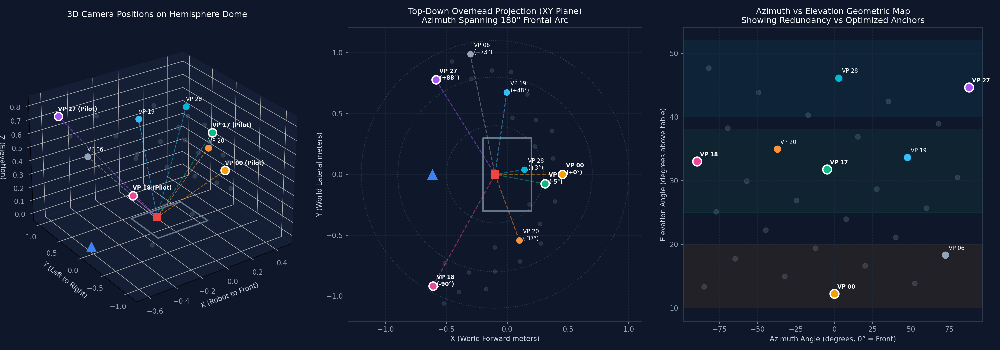
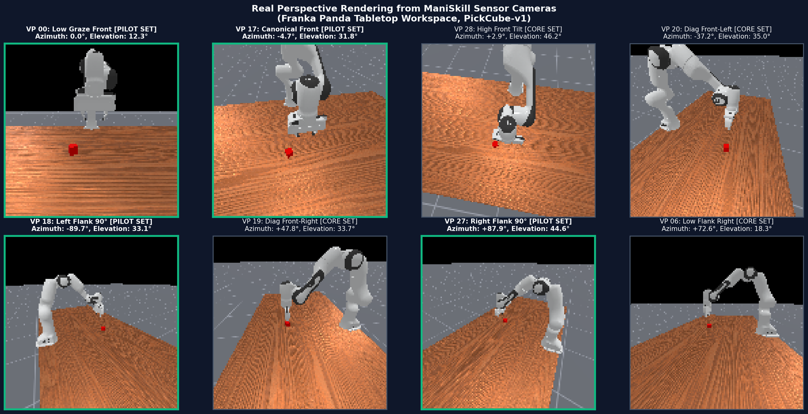
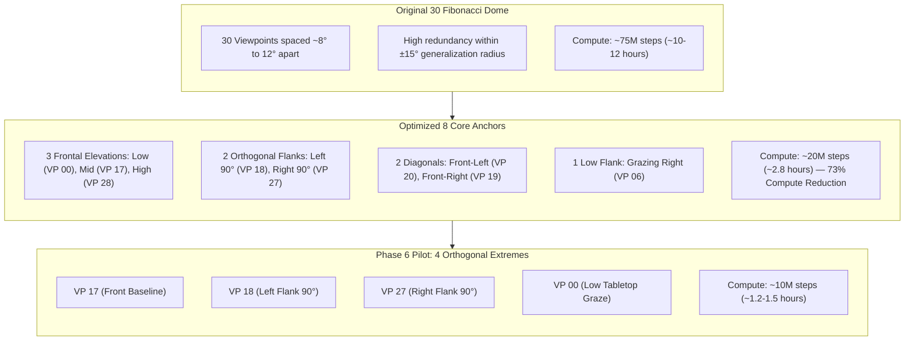

# Visual Guide: Camera Placement & Viewpoint Geometry

This visual document presents the 3D spatial layout, azimuthal coverage, and actual simulation camera perspectives around the Franka Panda workspace (`PickCube-v1`).

---

## 1. 3D Spatial Geometry & Placement Map

The diagram below visualizes the 3D hemisphere coordinates, overhead top-down radar projection, and azimuth vs. elevation distribution:

### Key Observations from the Geometry Map:
1. **Left Panel (3D Hemisphere):**
   - The Franka Panda robot base is mounted at $X = -0.615\text{ m}, Y = 0.0\text{ m}$ (blue triangle).
   - The manipulation table and target cube sit centered at $X = -0.1\text{ m}, Y = 0.0\text{ m}$ (red square).
   - Camera sightlines converge on the cube, maintaining a consistent sphere radius of $R \approx 1.094\text{ m}$ from the robot base.
2. **Center Panel (Top-Down Bird's Eye Projection):**
   - Demonstrates how the 8 Core Viewpoints span the complete $180^\circ$ frontal semi-circle without requiring redundant intermediate angles.
   - Highlights the 4 Pilot Viewpoints (**VP 17** Front, **VP 18** Left Flank $-90^\circ$, **VP 27** Right Flank $+90^\circ$, and **VP 00** Front Graze).
3. **Right Panel (Azimuth vs. Elevation Distribution):**
   - Shows all 30 Fibonacci points (gray dots) versus the 8 Core Anchors.
   - Highlights the high density of points separated by only $7^\circ\text{--}12^\circ$, confirming why 8 anchors adequately cover the 3 elevation tiers (Low $10^\circ\text{--}20^\circ$, Mid $25^\circ\text{--}38^\circ$, High $40^\circ\text{--}52^\circ$).

---

## 2. Actual Perspectives Rendered in ManiSkill

The grid below shows the exact visual observation ($128 \times 128$ RGB) perceived by the robot's camera from each strategic anchor point:

### Perspective Breakdown:

| Viewpoint ID | Category | Azimuth | Elevation | Visual Characteristics & Perspective Affordance |
| :---: | :---: | :---: | :---: | :--- |
| **VP 00** | **Pilot Set** | $0.0^\circ$ | $12.3^\circ$ | **Low Graze Front:** Shallow angle right above table surface. High horizontal parallax; difficult vertical depth discrimination. |
| **VP 17** | **Pilot Set** | $-4.7^\circ$ | $31.8^\circ$ | **Canonical Front (Baseline):** Established training pose. Balanced depth and vertical clearance of the gripper fingers. |
| **VP 28** | Core Set | $+2.9^\circ$ | $46.2^\circ$ | **High Front Tilt:** Steep angle looking down onto the table. Minimizes table occlusions and clarifies table contact plane. |
| **VP 20** | Core Set | $-37.2^\circ$ | $35.0^\circ$ | **Diagonal Front-Left:** $-45^\circ$ diagonal perspective. Asymmetric perspective of the Panda wrist articulation. |
| **VP 18** | **Pilot Set** | $-89.7^\circ$ | $33.1^\circ$ | **Orthogonal Left Flank ($90^\circ$):** Complete $90^\circ$ coordinate rotation. Forward/backward arm motion corresponds to lateral pixel motion. |
| **VP 19** | Core Set | $+47.8^\circ$ | $33.7^\circ$ | **Diagonal Front-Right:** $+45^\circ$ diagonal perspective with clear line-of-sight past the gripper finger. |
| **VP 27** | **Pilot Set** | $+87.9^\circ$ | $44.6^\circ$ | **Orthogonal Right Flank ($90^\circ$):** Opposing $90^\circ$ side angle with high elevation ($44.6^\circ$). Clean view of block face. |
| **VP 06** | Core Set | $+72.6^\circ$ | $18.3^\circ$ | **Low Flank Right:** Combines a strong flank angle with low grazing elevation. |

---

## 3. Structural Comparison: 30 Fibonacci vs. Optimized 8 Anchors

