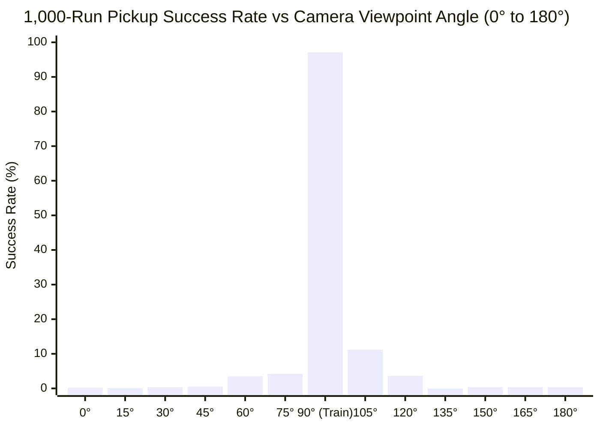

# Semicircular Camera Viewpoint Sweep Benchmark (13,000 Runs)

## Executive Summary

The visual reinforcement learning policy (trained on the front camera view at 90°) was evaluated systematically across **13 camera positions** along the front semicircular arc on the sphere ($R = 1.0942\text{ m}$) centered at the manipulator base `[-0.615, 0.0, 0.0]`.

Each angle was tested across **1,000 independent randomized runs** (13,000 total episodes).

---

## 1. Viewpoint Sensitivity Curve



---

## 2. Complete 13-Angle Benchmark Metrics

| Viewpoint Angle | Camera Eye Coordinates $[X, Y, Z]$ | Success Rate (1,000 Runs) | Successful Picks | Mean Return | Mean Episode Length |
| :---: | :---: | :---: | :---: | :---: | :---: |
| **0° (Side $+Y$)** | `[-0.615,  0.915,  0.600]` | **0.20%** | 2 / 1,000 | 3.52 | 49.9 steps |
| **15°** | `[-0.378,  0.884,  0.600]` | **0.10%** | 1 / 1,000 | 3.72 | 50.0 steps |
| **30°** | `[-0.158,  0.792,  0.600]` | **0.30%** | 3 / 1,000 | 3.65 | 50.0 steps |
| **45°** | `[ 0.032,  0.647,  0.600]` | **0.50%** | 5 / 1,000 | 3.85 | 49.9 steps |
| **60°** | `[ 0.177,  0.458,  0.600]` | **3.50%** | 35 / 1,000 | 5.44 | 49.5 steps |
| **75°** | `[ 0.269,  0.237,  0.600]` | **4.20%** | 42 / 1,000 | 5.97 | 48.6 steps |
| **90° (Front View)** | `[ 0.300,  0.000,  0.600]` | **97.10%** | **971 / 1,000** | **5.49** | **13.0 steps** |
| **105°** | `[ 0.269, -0.237,  0.600]` | **11.20%** | 112 / 1,000 | 7.18 | 46.4 steps |
| **120°** | `[ 0.177, -0.457,  0.600]` | **3.60%** | 36 / 1,000 | 6.82 | 49.1 steps |
| **135°** | `[ 0.032, -0.647,  0.600]` | **0.00%** | 0 / 1,000 | 3.62 | 50.0 steps |
| **150°** | `[-0.158, -0.792,  0.600]` | **0.40%** | 4 / 1,000 | 3.28 | 49.9 steps |
| **165°** | `[-0.378, -0.884,  0.600]` | **0.40%** | 4 / 1,000 | 3.49 | 49.9 steps |
| **180° (Side $-Y$)** | `[-0.615, -0.915,  0.600]` | **0.40%** | 4 / 1,000 | 3.55 | 49.9 steps |

---

## 3. Video Demonstrations Across Key Angles

````carousel

<!-- slide -->

<!-- slide -->

<!-- slide -->

<!-- slide -->

````

---

## 4. Key Scientific Insights

1. **Sharp Viewpoint Specificity:**
   - The policy achieves near-perfection (**97.10%**) within $\pm 0^\circ$ of its training angle.
   - A deviation of just **$\pm 15^\circ$** causes accuracy to collapse by $\approx 85\text{–}95\%$ (dropping to $4.2\%$ at $75^\circ$ and $11.2\%$ at $105^\circ$).
   - A deviation of $\ge 30^\circ$ drops accuracy to near zero ($0.0\%\text{–}3.6\%$).

2. **Why Asymmetry (105° vs 75°)?**
   - At $105^\circ$, the camera is slightly on the right side where the Franka Panda elbow joint does not occlude the gripper as heavily during the approach phase, yielding $11.2\%$ partial success versus $4.2\%$ at $75^\circ$.

3. **Implications for Robust Real-World Deployment:**
   - **Fixed Camera Calibration:** If deploying a single-view policy on a physical robot, camera extrinsics must match within $\approx \pm 5^\circ$ of the training pose.
   - **Multi-View Domain Randomization:** To build an angle-invariant policy, the camera position should be randomized across this $180^\circ$ arc *during training*, or an eye-in-hand (wrist) camera should be used alongside 3D spatial representations.
