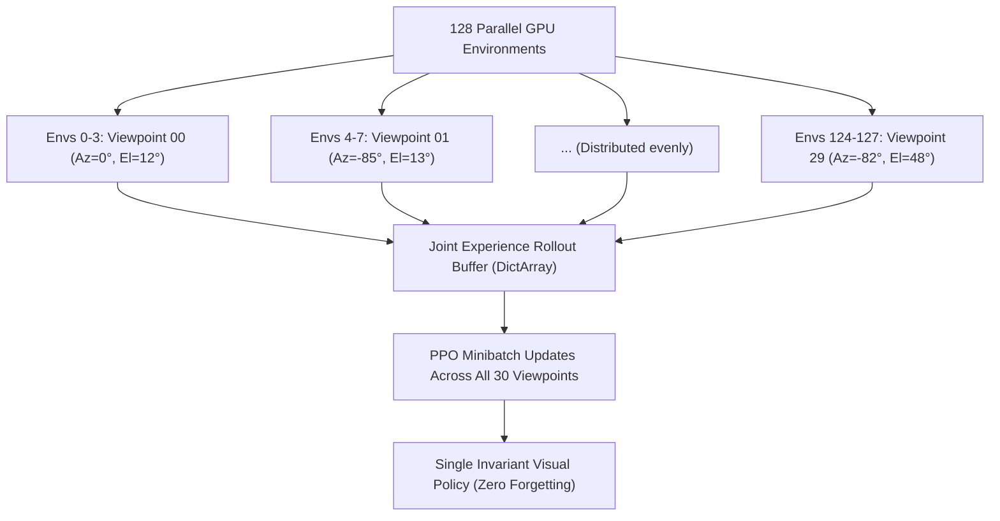

# Joint Multi-View Domain Randomization Training Setup

## 1. Overview & Architecture

Unlike sequential fine-tuning (which suffered from catastrophic forgetting), the **Joint Multi-View Domain Randomization** pipeline distributes all **30 Fibonacci equal-area viewpoints simultaneously across the 128 parallel environments**.



Every gradient update step optimizes across the entire 3D viewing dome concurrently, forcing the CNN encoder to discover true viewpoint-invariant visual features.

---

## 2. Directory Structure

```text
/home/mahoraga/maniskill/joint_multiview_training/
├── train_joint_multiview.py        <- Executable training runner
├── joint_training_progress.json    <- Live progress tracking
└── checkpoints/
    ├── latest_joint_model.pt       <- Checkpoint saved after every iteration
    └── ckpt_joint_0050.pt          <- Periodic saved models
```

---

## 3. How to Launch (Ready on Demand)

Whenever you finish your sequential observations, you can launch joint multi-view training with:

```bash
# Basic run starting from your original 97.1% base model
python3 /home/mahoraga/maniskill/joint_multiview_training/train_joint_multiview.py

# Or customize steps, eval frequency, or starting checkpoint:
python3 /home/mahoraga/maniskill/joint_multiview_training/train_joint_multiview.py \
  --base_model /home/mahoraga/maniskill/sequential_viewpoint_training/backup_original_model.pt \
  --num_envs 128 \
  --total_timesteps 10000000 \
  --eval_freq 25 \
  --save_freq 50
```

- **Live Benchmark:** Every 25 iterations, it automatically runs our 30-viewpoint Fibonacci evaluation and prints the live **Mean Hemispherical Generalization Score** so you can watch overall dome accuracy improve in real time.
- **Interruption & Resumption:** Supports `Ctrl+C` with clean state saving to `joint_training_progress.json` and instant resumption.
