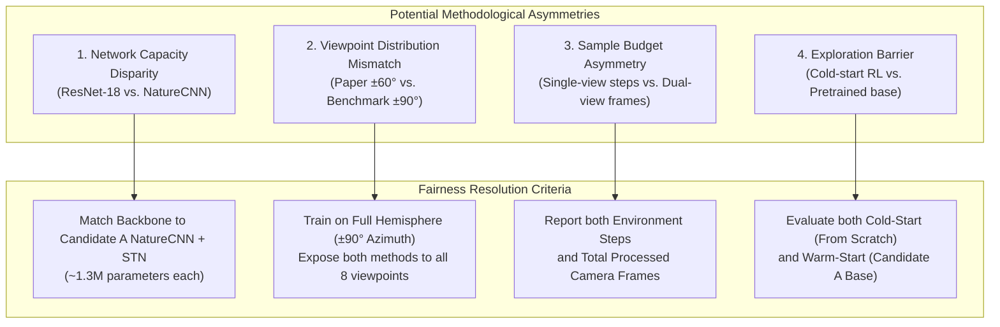

# Methodological Fairness Protocol: Multi-Teacher Distillation vs. Maniwhere

**Objective:** Define a rigorous, scientifically valid experimental protocol to compare **Multi-Teacher Policy Distillation** (Our Approach) against **Maniwhere** (CoRL 2024) without confounding variables or methodological bias.

---

## 1. Controlled Variables (Strictly Identical Across Both Methods)

To isolate the impact of the **training paradigm**, the following elements must be held strictly identical:

| Experimental Dimension | Controlled Specification | Purpose |
| :--- | :--- | :--- |
| **Physics Simulation & Task** | ManiSkill 3 `PickCube-v1` (PhysX GPU backend) | Eliminates physics and task discrepancy |
| **Action Space** | `pd_ee_delta_pos` (4-DoF: $\Delta x, \Delta y, \Delta z, \text{gripper}$) | Guarantees identical dynamics and control granularity |
| **Observation Modality** | $128 \times 128 \times 4$ RGB-D + 29-DoF Proprioception | Ensures both methods receive identical sensory cues |
| **Test-Time Information** | **Single camera only**; zero camera pose metadata | Neither model has privileged multi-view or extrinsic access |
| **Test Viewpoints** | 8 Strategic Viewpoints ($-89.7^\circ$ to $+87.9^\circ$ azimuth, $12.3^\circ$ to $46.2^\circ$ elevation) | Evaluates the full spatial spectrum equally |
| **Evaluation Benchmark** | **Identical 1,000 Randomized Test Sequence** (Seed 42) | Each trial has the exact same initial cube spawn and assigned camera |

---

## 2. Potential Asymmetries & How We Resolve Them

### Resolution 1: Network Architecture & Parameter Scale
- **The Issue:** The original Maniwhere paper used the first two layers of ResNet-18. If we gave Maniwhere a larger ResNet-18 while Distillation used NatureCNN, any difference could simply be backbone capacity.
- **The Fair Solution:** We integrate the **Perspective STN directly into Candidate A NatureCNN**. Both models have $\approx 1.2\text{M} - 1.4\text{M}$ parameters. Any performance difference is strictly attributable to the **learning objective** (contrastive + homography vs. behavioral distillation), not parameter count.

### Resolution 2: Camera Viewpoint Coverage During Training
- **The Issue:** The original Maniwhere paper trained with azimuth in $[-60^\circ, +60^\circ]$. However, our benchmark includes $90^\circ$ lateral flank cameras (VP 18 at $-89.7^\circ$ and VP 27 at $+87.9^\circ$). Testing Maniwhere on $\pm 90^\circ$ without training on them would make it an unfair out-of-distribution test.
- **The Fair Solution:** During training, Maniwhere's moving camera must cycle across or sample from the **entire set of 8 strategic viewpoints** (spanning $-89.7^\circ$ to $+87.9^\circ$). Both methods see the exact same camera distribution during training.

### Resolution 3: Environment Steps vs. Processed Camera Frames
- **The Issue:** In our distillation pipeline, 8 specialists ran independently ($\approx 26.5\text{M}$ total env steps), followed by 80k rollout transitions. In Maniwhere, every single env step renders **two camera frames** simultaneously ($o^{\text{fixed}}$ and $o^{\text{move}}$).
- **The Fair Solution:** We will explicitly log and report both:
  1. *Total Environment Steps* (simulator interaction cost).
  2. *Total Rendered Camera Frames* (visual processing cost).
  3. *Total Training Walltime* (compute cost on the RTX 4060 GPU).

### Resolution 4: Exploration Inflection Barrier (Cold-Start vs. Warm-Start)
- **The Issue:** In Phase 6, we discovered that visual PPO on `PickCube-v1` requires $2.5\text{M} - 3.2\text{M}$ steps just to discover the grasp bottleneck from scratch (plateauing at 2% before jumping to 95%). If Maniwhere is trained for only 1M steps from scratch, it might fail simply because it hasn't discovered grasping yet.
- **The Fair Solution:** We can test **both**:
  - **Maniwhere (From Scratch):** Standard 3.0M steps cold-start.
  - **Maniwhere (Warm-Start from Candidate A manipulation base):** Both the policy and STN start from a model that already knows how to grasp, isolating whether the multi-view contrastive loss can successfully align the moving viewpoints without getting stuck in exploration.

---

## 3. The 3-Way Comparative Benchmark

Once trained, we will evaluate both variants against our existing results on the exact same 1,000-trial sequence:

| Approach | Architecture | Training Paradigm | Total Steps | 1,000-Test Overall Accuracy | Viable Views Accuracy |
| :--- | :--- | :--- | :---: | :---: | :---: |
| **Approach 1: Multi-Teacher Distillation** | NatureCNN | Modular Specialists + Offline DAgger | 26.5M RL + 80k Rollouts | **80.90%** | **90.30%** |
| **Approach 2: Federated Policy Aggregation** | NatureCNN | Distributed PPO + Parameter Averaging | 1.92M RL | 0.25% | 0.29% |
| **Approach 3A: Maniwhere (Cold-Start)** | NatureCNN + STN | Joint PPO + Dual-View InfoNCE + Feat MSE | 3.0M RL (6.0M frames) | *To be measured* | *To be measured* |
| **Approach 3B: Maniwhere (Warm-Start)** | NatureCNN + STN | Warm-started PPO + Dual-View Contrastive | 1.5M RL (3.0M frames) | *To be measured* | *To be measured* |
