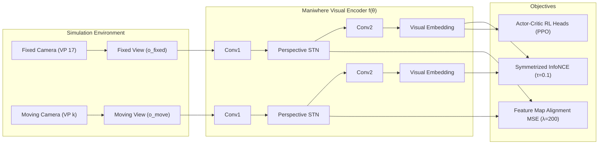

# Paper Analysis & Replication Plan: Maniwhere (CoRL 2024)
**"Learning to Manipulate Anywhere: A Visual Generalizable Framework For Reinforcement Learning"**

- **Paper Authors:** Zhecheng Yuan, Tianming Wei, Shuiqi Cheng, Gu Zhang, Yuanpei Chen, Huazhe Xu (Tsinghua IIIS, SJTU, HKU, PKU, Shanghai AI Lab)
- **Conference:** 8th Conference on Robot Learning (CoRL 2024), Munich, Germany
- **Core Research Question:** *How can a single visual RL policy generalize zero-shot across diverse camera viewpoints without requiring camera recalibration, camera pose metadata, or multi-view deployment?*

---

## 1. Deep Dive: What Does Maniwhere Do?

### The Three Pillars of Maniwhere

#### 1. Dual-Camera Multi-View Representation Learning
During training in simulation, Maniwhere captures **two simultaneous image streams** at every timestep $t$:
- $o^{\text{fixed}}$: From a fixed, canonical reference viewpoint.
- $o^{\text{move}}$: From a moving viewpoint whose camera position varies dynamically (azimuth $[-60^\circ, +60^\circ]$, elevation $[10.5^\circ, 30.5^\circ]$).

Both images pass through the shared visual encoder $f_\theta$, and the network optimizes a composite multi-view representation loss:
$$\mathcal{L}_{\text{Maniwhere}}(\theta) = J_{\text{con}}(\theta) + \lambda J_{\text{feat}}(\theta) \quad (\lambda = 200)$$

1. **Symmetrized InfoNCE Contrastive Loss $J_{\text{con}}(\theta)$:**
   $$J_{\text{con}}(\theta) = -\log \frac{\exp(f(o^{\text{fixed}})^T \cdot f(o^{\text{move}+}) / \tau)}{\exp(f(o^{\text{fixed}})^T \cdot f(o^{\text{move}+}) / \tau) + \sum_{\text{move}-} \exp(f(o^{\text{fixed}})^T \cdot f(o^{\text{move}-}) / \tau)}$$
   Pulls together representations of the same scene rendered simultaneously from different perspectives while pushing apart negative samples from different timesteps.
2. **Feature Map Alignment Loss $J_{\text{feat}}(\theta)$:**
   $$J_{\text{feat}}(\theta) = \frac{1}{|B|} \sum_{(o^{\text{fixed}}, o^{\text{move}}) \in B} \|F(o^{\text{fixed}}) - F(o^{\text{move}})\|_2^2$$
   Directly penalizes differences between intermediate feature map activations across views.

#### 2. Perspective Spatial Transformer Network (STN)
Standard 2D STNs apply an affine transformation (6 degrees of freedom). However, 3D viewpoint changes cause **perspective distortion and foreshortening**. Maniwhere modifies the STN to predict a **$3 \times 3$ perspective homography matrix**:
$$\begin{pmatrix} x^s \\ y^s \\ 1 \end{pmatrix} \sim \begin{bmatrix} \theta_{11} & \theta_{12} & \theta_{13} \\ \theta_{21} & \theta_{22} & \theta_{23} \\ \theta_{31} & \theta_{32} & 1 \end{bmatrix} \begin{pmatrix} x^t \\ y^t \\ 1 \end{pmatrix}$$
- **Function:** The STN actively warps the features from the moving camera to align geometrically with the canonical camera's perspective before feeding into the deeper conv layers.

#### 3. Single-View Zero-Shot Deployment
At test time (and during real-robot deployment), the policy operates using **only a single camera from an arbitrary perspective**. The learned STN and contrastive encoder rectify the visual features into the canonical coordinate frame internally.

---

## 2. Paradigmatic Comparison: Maniwhere vs. Our Policy Distillation

| Dimension | Our Approach (Phase 6–7) | Maniwhere (CoRL 2024) |
| :--- | :--- | :--- |
| **Philosophy** | **Modular Specialization + Behavioral Distillation** | **End-to-End Auxiliary Multi-View Representation** |
| **Training Complexity** | Two-stage: 1) Train independent teachers; 2) Distill to student | Single-stage: Joint RL + Contrastive loss |
| **Simulation Requirement** | Single standard camera per training run | **Synchronous dual-camera rendering** per timestep |
| **Gradient Interference** | **Zero** (stationary teacher oracles supervise student) | Handled via auxiliary loss balancing ($\beta=0.5, \lambda=200$) |
| **View Alignment Mechanism** | Action-space imitation across diverse viewpoint datasets | **Perspective STN** feature map warping |
| **Zero-Shot Test Accuracy** | **80.90% overall (90.30% on viable views)** | Reported ~81.5%–89.5% on tabletop manipulation |
| **Inference Input** | Single camera ($128 \times 128$ RGB-D) | Single camera ($128 \times 128$ RGB-D) |

---

## 3. Implementation of the Maniwhere Replication (Phase 9)

We have implemented the complete Maniwhere pipeline tailored to ManiSkill 3 `PickCube-v1`:

1. **Dual-Camera Environment ([`pick_cube_dual_view.py`](file:///home/maniskill/phase_9_maniwhere_replication/pick_cube_dual_view.py)):**
   - Subclasses `PickCubeEnv` with simultaneous GPU rendering of `cam_canonical` (VP 17) and `cam_moving` (sampled from the 7 alternate viewpoints).
   - Wrapped via `DualViewWrapper` to output synchronized `(o_fixed, o_move)` observation tuples.
2. **Model Architecture ([`models_maniwhere.py`](file:///home/maniskill/phase_9_maniwhere_replication/models_maniwhere.py)):**
   - `PerspectiveSTN`: Predicts 8 homography parameters initialized to identity, using bilinear grid sampling with border padding.
   - `ManiwhereVisualEncoder`: Integrates NatureCNN backbone with embedded STN and a 2-layer contrastive MLP projection head.
   - `ManiwhereAgent`: Computes PPO policy/value updates alongside `compute_maniwhere_representation_loss()`.
3. **Training Script ([`train_maniwhere.py`](file:///home/maniskill/phase_9_maniwhere_replication/train_maniwhere.py)):**
   - End-to-end PPO training with the joint objective:
     $$\mathcal{L}_{\text{total}} = \mathcal{L}_{\text{PPO}} + 0.5 \left( J_{\text{con}}(\tau=0.1) + 200 \cdot J_{\text{feat}} \right)$$
   - Periodic single-view evaluation across all 8 viewpoints.
4. **Benchmarking ([`evaluate_maniwhere_1000_tests.py`](file:///home/maniskill/phase_9_maniwhere_replication/evaluate_maniwhere_1000_tests.py)):**
   - Evaluates the trained Maniwhere model on the identical 1,000 randomized viewpoint test sequence, generating a direct head-to-head comparison against our Distilled Unified Policy.
