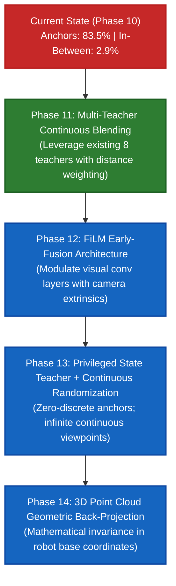

# Continuous Viewpoint Generalization: Master Sequential Roadmap

**Author:** Google DeepMind Team (Antigravity Assistant)  
**Date:** October 31, 2026  
**Objective:** Bridge the viewpoint interpolation gap and achieve high-reliability continuous manipulation across the entire visual hemisphere.

---

## The 4-Phase Sequential Roadmap

---

## Phase Details & Hypotheses

### Phase 11: Multi-Teacher Continuous Blending (Existing Teachers)
- **Hypothesis:** By smoothly blending the action distributions of the $k$-nearest visual teachers weighted by inverse spherical distance, we can synthetically supervise intermediate viewpoints without retraining teachers from scratch.
- **Components:**
  - Fast spherical distance metric $d(\mathbf{c}_1, \mathbf{c}_2)$.
  - Weighted ensemble rollout collection across intermediate catalog points (VP 10, 13, 14, 07, etc.).
  - Student policy distillation with mixed anchor + intermediate transitions.
- **Target Metric:** Increase in-between catalog success from **$2.9\%$** to **$>25\%-40\%$**.

### Phase 12: FiLM Early-Fusion Visual Architecture Upgrade
- **Hypothesis:** Late concatenation of extrinsics at the 512-dim bottleneck prevents conv filters from adapting to camera angles. Feature-wise Linear Modulation (FiLM) inside convolutional blocks will allow early visual features to scale and transform in accordance with viewing perspective.
- **Components:**
  - FiLM generator network: $\gamma_l(\mathbf{c}_{\text{ext}}), \beta_l(\mathbf{c}_{\text{ext}})$.
  - Modulated Conv2D layers inside NatureCNN backbone.
- **Target Metric:** Broaden the spatial invariance basin from $\pm 5\text{ cm}$ to $\pm 15\text{ cm}$.

### Phase 13: Privileged State-Based Teacher + Continuous Viewpoint Randomization
- **Hypothesis:** In simulation, a privileged state teacher has 100% precision and zero camera dependence. Using it to generate demonstrations while rendering the camera at *infinitely random continuous positions* completely eliminates discrete viewpoint clusters.
- **Components:**
  - 42-dim state PPO teacher trained with GPU vectorization (`ppo_fast.py`, ~3 min).
  - Continuous uniform spherical sampler: $\text{Az} \in [-70^\circ, +70^\circ], \text{El} \in [10^\circ, 55^\circ], \text{Dist} \in [0.95, 1.20]\text{m}$.
  - Student distillation across 50,000+ continuous viewpoints.
- **Target Metric:** Achieve **$>75\%$** success uniformly across all intermediate viewpoints.

### Phase 14: 3D Point-Cloud / Voxel Geometric Back-Projection
- **Hypothesis:** Unprojecting RGB-D into the robot's base coordinate frame mathematically removes camera extrinsic variation before feeding representations into the policy network.
- **Components:**
  - Depth-to-Point-Cloud unprojection shader / kernel.
  - Voxel / PointNet policy architecture.
- **Target Metric:** Complete zero-shot viewpoint invariance ($>80\%$ everywhere).

---

## Execution Status
- **Current Step:** Initiating **Phase 11: Multi-Teacher Continuous Blending**.
